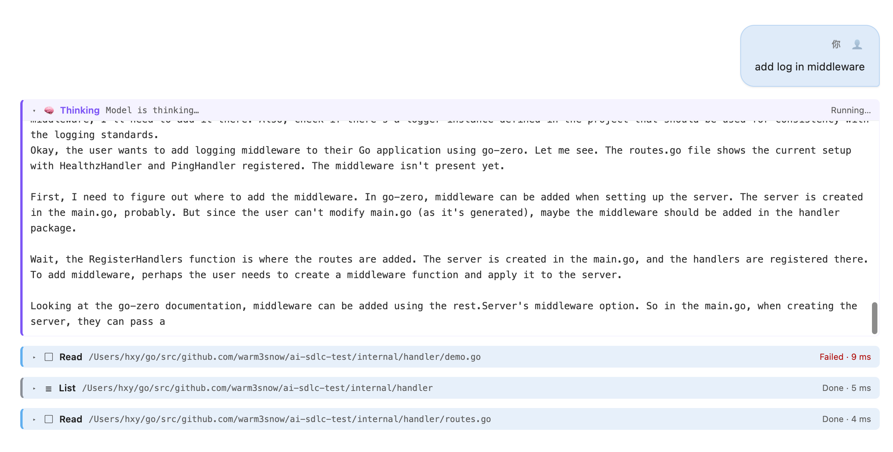
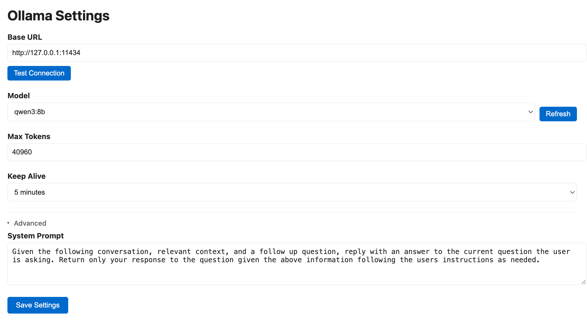

# VSCode Ollama

<p align="center">
  
</p>

<p align="center">
  <a href="https://marketplace.visualstudio.com/items?itemName=warm3snow.vscode-ollama">
    
  </a>
  <a href="https://marketplace.visualstudio.com/items?itemName=warm3snow.vscode-ollama">
    
  </a>
  <a href="https://github.com/warm3snow/vscode-ollama">
    
  </a>
  <a href="https://github.com/warm3snow/vscode-ollama/blob/main/LICENSE">
    
  </a>
</p>

<p align="center">
  <a href="README.md">English</a> · <a href="README_CN.md">中文</a>
</p>

将 [Ollama](https://ollama.com) 的强大能力带入 VS Code —— 无需离开编辑器，即可运行本地大模型、进行对话，并让自主编码 Agent 读取与修改你的工作区。

## ✨ 特性

| | |
|---|---|
| 🤖 **本地大模型** | 通过 Ollama 本地运行模型，低延迟、数据私密，支持随时切换模型。 |
| 💬 **智能对话** | 流式输出、思考过程可视化、对话历史保存。 |
| 🛠️ **编码 Agent** | 自主 Agent 内置 `read` / `write` / `edit` / `grep` / `find` / `ls` / `bash` 工具，可读取并修改工作区；危险操作执行前会请求确认。 |
| 🧩 **子 Agent 委派** | 内置 `codebase-search` / `plan` / `implement` / `review` 子 Agent，支持串行与并行委派。 |
| ⚙️ **灵活配置** | 自定义服务器地址、模型、Token 上限，以及 Agent 的工具与确认策略。 |

## 📸 截图

<p align="center">
  
  <br/>
  <em>聊天界面与实时 Agent 活动</em>
</p>

<p align="center">
  
  <br/>
  <em>设置页面</em>
</p>

## 🚀 安装

### 1. 安装 Ollama

```bash
# macOS
brew install ollama

# Linux
curl -fsSL https://ollama.com/install.sh | sh
```

使用前拉取模型：

```bash
ollama pull qwen2.5-coder:7b
```

### 2. 安装扩展

在 VS Code 中打开扩展市场，搜索 **"VSCode Ollama"**，点击 **安装**。

### 3. 配置

打开命令面板（`Ctrl+Shift+P` / `Cmd+Shift+P`），运行 **"Ollama: Settings"**，设置服务器地址与默认模型。

## 📖 使用说明

打开命令面板，运行 **"Ollama: Open Chat"** 开始对话。

### 命令

| 命令 | 说明 |
|---|---|
| `Ollama: Open Chat` | 打开聊天界面 |
| `Ollama: Settings` | 打开设置页面 |

### 快捷键

| 快捷键 | 操作 |
|---|---|
| `Enter` | 发送消息 |
| `Shift + Enter` | 输入换行 |

### 配置项

| 配置项 | 默认值 | 说明 |
|---|---|---|
| `vscode-ollama.baseUrl` | `http://127.0.0.1:11434` | Ollama 服务器地址 |
| `vscode-ollama.model` | `deepseek-r1:32b` | 默认模型 |
| `vscode-ollama.maxTokens` | `4096` | 回复的最大 Token 数 |
| `vscode-ollama.keepAlive` | `5 minutes` | 模型保活时长 |
| `vscode-ollama.systemPrompt` | — | 对话使用的系统提示 |

### 编码 Agent

聊天请求默认以 Agent 模式处理：模型自行决定读取哪些文件、执行哪些命令、如何修改代码，并在界面上展示思考、工具调用与结果。

Agent 支持 `/reset` 命令，用于清空上下文并结束当前会话。

Agent 可以将任务委派给拥有独立上下文的子 Agent：

- `codebase-search` — 定位相关代码并返回结构化调研结果
- `plan` — 将上下文与需求整理为具体的实施计划
- `implement` — 使用全部工具自主完成任务
- `review` — 从质量与安全角度审查代码

> ⚠️ Agent 模式需要 Node ≥ 22.19（对应较新版本的 VS Code）。在更老的版本上普通聊天模式不受影响，Agent 模式会给出明确的提示。
>
> 另外，本地模型需具备 tool calling 能力才能真正驱动工具调用。

## 🤝 支持

如果这个扩展对你有帮助，可以通过以下方式支持：

- ⭐ 在 [仓库](https://github.com/warm3snow/vscode-ollama) 上给个星标
- 🚀 为代码库做贡献
- 💬 分享给朋友

## 📄 发布说明

查看 [CHANGELOG.md](CHANGELOG.md)。

## 📄 许可证

基于 [MIT 许可证](LICENSE) 授权。

## ⭐ Star 趋势

[](https://star-history.com/#warm3snow/vscode-ollama&Date)
